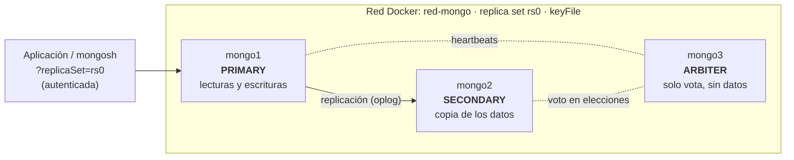

# EduPlatform - Plataforma de E-learning

**Autor:** Aquiles Ferreyra Arca

## Índice

1. [Descripción del Proyecto](#descripción-del-proyecto)
2. [Modelo de Datos](#modelo-de-datos)
3. [Fundamentación de la Lógica No Relacional](#fundamentación-de-la-lógica-no-relacional)
4. [Pruebas de Consultas (MQL)](#pruebas-de-consultas-mql)
5. [Fase 3: Resiliencia, Transacciones y Securización](#fase-3-resiliencia-transacciones-y-securización)

---

## Descripción del Proyecto

EduPlatform es una plataforma de aprendizaje en línea diseñada para gestionar cursos, estudiantes, instructores, evaluaciones y el seguimiento del progreso académico.

El objetivo del sistema es centralizar la administración de contenidos educativos y facilitar el acceso a la información tanto para estudiantes como para instructores.

La base de datos tendrá un rol fundamental en el almacenamiento y recuperación eficiente de información relacionada con:

- Usuarios del sistema.
- Cursos y contenidos educativos.
- Inscripciones de estudiantes.
- Evaluaciones.
- Resultados y progreso académico.

El proyecto utilizará un enfoque NoSQL orientado a documentos, modelando la información de acuerdo con los patrones de consulta más frecuentes de la aplicación.

## Modelo de Datos

### Colección: usuarios

Almacena la información de estudiantes e instructores.

```json
{
  "_id": "usr001",
  "nombre": "Juan Pérez",
  "email": "juan@email.com",
  "rol": "estudiante",
  "fechaRegistro": "2026-08-18"
}
```

**Campos**

| Campo | Tipo |
|---|---|
| _id | String |
| nombre | String |
| email | String |
| rol | String |
| fechaRegistro | Date |

### Colección: cursos

Contiene la información principal de cada curso junto con sus módulos y lecciones.

```json
{
  "_id": "cur001",
  "titulo": "MongoDB para Principiantes",
  "descripcion": "Curso introductorio a bases de datos NoSQL",
  "categoria": "Bases de Datos",
  "instructorId": "usr010",
  "modulos": [
    {
      "titulo": "Introducción",
      "lecciones": [
        {
          "titulo": "¿Qué es MongoDB?",
          "duracionMin": 20
        },
        {
          "titulo": "Instalación y configuración",
          "duracionMin": 30
        }
      ]
    }
  ]
}
```

**Campos**

| Campo | Tipo |
|---|---|
| _id | String |
| titulo | String |
| descripcion | String |
| categoria | String |
| instructorId | Reference |
| modulos | Array |

### Colección: inscripciones

Relaciona estudiantes con cursos.

```json
{
  "_id": "ins001",
  "estudianteId": "usr001",
  "cursoId": "cur001",
  "fechaInscripcion": "2026-08-18",
  "progreso": 65
}
```

**Campos**

| Campo | Tipo |
|---|---|
| _id | String |
| estudianteId | Reference |
| cursoId | Reference |
| fechaInscripcion | Date |
| progreso | Number |

### Colección: evaluaciones

Almacena evaluaciones asociadas a cada curso.

```json
{
  "_id": "eva001",
  "cursoId": "cur001",
  "titulo": "Evaluación Final",
  "preguntas": [
    {
      "enunciado": "¿Qué tipo de base de datos es MongoDB?",
      "opciones": [
        "Relacional",
        "NoSQL",
        "Jerárquica"
      ],
      "respuestaCorrecta": "NoSQL"
    }
  ]
}
```

**Campos**

| Campo | Tipo |
|---|---|
| _id | String |
| cursoId | Reference |
| titulo | String |
| preguntas | Array |

### Colección: resultados

Registra los resultados obtenidos por los estudiantes en las evaluaciones.

```json
{
  "_id": "res001",
  "evaluacionId": "eva001",
  "estudianteId": "usr001",
  "puntaje": 90,
  "fecha": "2026-08-20"
}
```

**Campos**

| Campo | Tipo |
|---|---|
| _id | String |
| evaluacionId | Reference |
| estudianteId | Reference |
| puntaje | Number |
| fecha | Date |

## Fundamentación de la Lógica No Relacional

### Uso de Documentos Embebidos

#### Módulos y lecciones dentro de cursos

Los módulos y las lecciones se modelaron como documentos embebidos dentro de la colección de cursos debido a que habitualmente son consultados junto con el curso completo.

Cuando un usuario accede a un curso, necesita visualizar toda su estructura académica, por lo que resulta conveniente obtener la información en una sola consulta.

**Beneficios:**

- Menor cantidad de consultas a la base de datos.
- Mejor rendimiento de lectura.
- Modelo más cercano a la estructura utilizada por la aplicación.

#### Preguntas dentro de evaluaciones

Las preguntas fueron embebidas dentro de cada evaluación porque dependen exclusivamente de ella y no poseen utilidad de manera independiente.

**Beneficios:**

- Recuperación completa de la evaluación en una única consulta.
- Menor complejidad de modelado.
- Reducción de operaciones de búsqueda.

### Uso de Referencias

#### Instructor referenciado desde cursos

Los cursos almacenan únicamente el identificador del instructor mediante el campo `instructorId`.

**Motivo:**

Un instructor puede estar asociado a múltiples cursos. Si sus datos fueran duplicados en cada curso, cualquier modificación requeriría actualizar numerosos documentos.

**Beneficios:**

- Evita redundancia de información.
- Mantiene consistencia de datos.
- Simplifica futuras actualizaciones.

#### Inscripciones

La relación entre estudiantes y cursos se implementó mediante una colección independiente de inscripciones.

**Motivo:**

Existe una relación muchos a muchos entre estudiantes y cursos. Un estudiante puede inscribirse en varios cursos y un curso puede contener numerosos estudiantes.

**Beneficios:**

- Mayor flexibilidad.
- Menor duplicación de datos.
- Escalabilidad para grandes volúmenes de usuarios.

#### Resultados de evaluaciones

Los resultados se almacenan en una colección separada.

**Motivo:**

La cantidad de resultados puede crecer significativamente con el tiempo. Embebirlos dentro de evaluaciones o usuarios generaría documentos demasiado grandes y difíciles de mantener.

**Beneficios:**

- Mejor escalabilidad.
- Consultas más eficientes.
- Menor crecimiento de documentos principales.

## Pruebas de Consultas (MQL)

Los scripts completos están en `/scripts/consultas.js`. Los archivos de datos de sembrado están en `/scripts/*.json`.

### Lecturas

#### 1. Filtrado exacto — cursos por categoría

```js
db.cursos.find({ categoria: "Bases de Datos" });
```

**Resuelve:** mostrar el catálogo de cursos filtrado por categoría en la página principal.


#### 2. Comparación — estudiantes aprobados

```js
db.resultados.find({ puntaje: { $gte: 70 } });
```

**Resuelve:** identificar a los estudiantes que aprobaron una evaluación para emitir su constancia.


#### 3. Dot notation — búsqueda en lecciones anidadas

```js
db.cursos.find({ "modulos.lecciones.titulo": "Instalación" });
```

**Resuelve:** alimentar el buscador interno de contenidos por título de lección.


#### 4. Proyección — listado liviano de usuarios

```js
db.usuarios.find({ rol: "estudiante" }, { _id: 0, nombre: 1, email: 1 });
```

**Resuelve:** exportar nombre y email de estudiantes para una campaña de correo, sin exponer el `_id`.


#### 5. Filtrado de arreglo con $elemMatch

```js
db.evaluaciones.find({ preguntas: { $elemMatch: { respuestaCorrecta: "NoSQL" } } });
```

**Resuelve:** auditar el banco de preguntas para encontrar evaluaciones con una respuesta correcta específica.


### Actualizaciones y eliminación

#### 1. $set — actualizar y añadir propiedad

```js
db.cursos.updateOne(
  { _id: "cur001" },
  { $set: { descripcion: "Curso introductorio a MongoDB, actualizado con ejemplos prácticos", certificadoDisponible: true } }
);
```

**Resuelve:** el instructor mantiene actualizada la descripción del curso y habilita el certificado.


#### 2. $inc — incrementar contador

```js
db.Inscripciones.updateOne(
  { estudianteId: "usr001", cursoId: "cur001" },
  { $inc: { progreso: 10 } }
);
```

**Resuelve:** reflejar el avance de un estudiante en su curso de forma atómica.


#### 3. deleteOne — eliminación segura

```js
db.resultados.deleteOne({ evaluacionId: "eva999", puntaje: 0 });
```

**Resuelve:** depurar registros de prueba bajo un criterio estricto que no afecta datos reales.


---

# Fase 3: Resiliencia, Transacciones y Securización

En esta fase la base de datos pasó de un entorno aislado a un **sistema distribuido, tolerante a fallos, consistente mediante transacciones ACID y protegido contra accesos no autorizados**. Todo el laboratorio corre en contenedores Docker con MongoDB 8.0.

**Contenido de la fase**

1. [Diagrama de arquitectura](#1-diagrama-de-arquitectura)
2. [Alta disponibilidad: Replica Set y Failover](#2-alta-disponibilidad-replica-set-y-failover)
3. [Bitácora del failover](#3-bitácora-del-failover)
4. [Transacciones ACID multi-documento](#4-transacciones-acid-multi-documento)
5. [Reporte de securización](#5-reporte-de-securización)
6. [Estructura de la fase y cómo reproducirla](#6-estructura-de-la-fase-y-cómo-reproducirla)

## 1. Diagrama de arquitectura

Tres contenedores unidos por una red Docker propia (`red-mongo`) forman el replica set `rs0`. La aplicación se conecta con una cadena que indica el nombre del set, por lo que el driver siempre localiza al primario vigente, incluso después de una elección.



| Nodo | Rol | Guarda datos | Vota |
|---|---|---|---|
| mongo1 | Primario (inicial) | Sí | Sí |
| mongo2 | Secundario (inicial) | Sí | Sí |
| mongo3 | Árbitro | No | Sí |

> Los roles son los iniciales. Tras la prueba de failover, `mongo2` quedó como primario y `mongo1` volvió como secundario: el rol lo define la elección, no el nombre del contenedor.

**Distribución de los datos:** las cinco colecciones de `eduplatform` (usuarios, cursos, evaluaciones, inscripciones y resultados) viven en el primario y se replican al secundario. El árbitro no almacena datos: su función es desempatar elecciones.

## 2. Alta disponibilidad: Replica Set y Failover

### Creación del clúster

```powershell
docker network create red-mongo
docker exec -it mongo1 mongosh --eval "rs.initiate({_id: 'rs0', members: [{_id: 0, host: 'mongo1:27017'}, {_id: 1, host: 'mongo2:27017'}, {_id: 2, host: 'mongo3:27017'}]})"
```

### Conversión del tercer nodo en árbitro

Un árbitro no guarda datos, por lo que `mongo3` se quitó del set, se recreó vacío y se volvió a agregar con `addArb`. Desde MongoDB 5.0 hay que definir antes el *write concern* por defecto (es un comando de base de datos, no un método de `rs`):

```js
db.adminCommand({ setDefaultRWConcern: 1, defaultWriteConcern: { w: 1 } })
rs.remove("mongo3:27017")
// recrear mongo3 vacío (docker rm -f mongo3 + docker run ...)
rs.addArb("mongo3:27017")
```

Al reincorporar a `mongo2` como secundario, MongoDB rechazó el cambio: una topología **PSA** (Primario–Secundario–Árbitro) con un único nodo de datos no admite sumar de golpe un secundario votante. Se resolvió quitando temporalmente el árbitro, agregando el secundario, esperando su sincronización y reponiendo el árbitro:

```js
rs.remove("mongo3:27017")
rs.add("mongo2:27017")        // esperar a que pase de STARTUP2 a SECONDARY
rs.addArb("mongo3:27017")
```

Estado resultante:

```text
[ 'mongo1:27017 -> PRIMARY',
  'mongo2:27017 -> SECONDARY',
  'mongo3:27017 -> ARBITER' ]
```

### Carga y verificación de la replicación

Los datos de la Fase 2 se importaron en el primario con `docker cp` y `mongoimport`. En el secundario, la lectura requiere habilitarse y la escritura siempre es rechazada:

```js
db.usuarios.countDocuments()
// MongoServerError: not primary and secondaryOk=false

db.getMongo().setReadPref("secondaryPreferred")
db.usuarios.countDocuments()   // 12  -> los datos llegaron al secundario

db.usuarios.insertOne({ nombre: "Prueba" })
// MongoServerError: not primary  -> un secundario no acepta escrituras
```

## 3. Bitácora del failover

### Script de inserción continua

[`Fase 3/scripts/insercion-continua.js`](Fase%203/scripts/insercion-continua.js) inserta un documento cada 500 ms con `w: 1`:

```js
const col = db.getSiblingDB("eduplatform").failover_test;
let i = 0;
while (true) {
  try {
    col.insertOne({ n: i, ts: new Date() }, { writeConcern: { w: 1 } });
    print(new Date().toISOString() + " OK " + i);
  } catch (e) {
    print(new Date().toISOString() + " ERROR " + i + ": " + e.message);
  }
  i++;
  sleep(500);
}
```

Se ejecutó desde el contenedor del árbitro (el nodo que no iba a detenerse), con una cadena de conexión al replica set:

```powershell
docker cp scripts\insercion-continua.js mongo3:/tmp/insercion-continua.js
docker exec -it mongo3 mongosh "mongodb://mongo1:27017,mongo2:27017/eduplatform?replicaSet=rs0" /tmp/insercion-continua.js
```

### Paso a paso

**1. Estado antes de la caída.** `mongo1` es el primario y el script inserta sin errores.

```powershell
docker exec mongo2 mongosh --quiet --eval "rs.status().members.map(m => m.name + ' -> ' + m.stateStr)"
```

```text
[ 'mongo1:27017 -> PRIMARY', 'mongo2:27017 -> SECONDARY', 'mongo3:27017 -> ARBITER' ]
```
**2. Caída del primario.** Con el script corriendo, se detiene el contenedor del primario:

```powershell
docker kill mongo1
```

```text
[ 'mongo1:27017 -> (not reachable/healthy)', 'mongo2:27017 -> SECONDARY', 'mongo3:27017 -> ARBITER' ]
```
**3. Votación y elección.** Los nodos restantes (`mongo2` y el árbitro `mongo3`) forman la mayoría de 2 sobre 3 votos. El árbitro vota a favor de `mongo2`, que es promovido a primario.
**4. Recuperación del nodo caído.** Al reiniciar `mongo1`, se reincorpora como secundario:

```powershell
docker start mongo1
```

```text
[ 'mongo1:27017 -> SECONDARY', 'mongo2:27017 -> PRIMARY', 'mongo3:27017 -> ARBITER' ]
```
### Lo que muestra el log del script

```text
2026-10-16T21:47:13.557Z OK 88
2026-10-16T21:47:14.060Z OK 89
                          <- caída del primario y elección (~30 s)
2026-10-16T21:47:44.028Z OK 90
2026-10-16T21:47:44.531Z OK 91
```

- **Sin pérdida de datos:** el script insertó del 0 al 231 sin saltos y `db.failover_test.countDocuments()` devolvió **232**.
- **Pausa de ~30 segundos** entre el `OK 89` y el `OK 90`: es el tiempo de la elección. El driver retuvo la escritura (*retryable writes*) hasta que hubo un nuevo primario y la reintentó, por eso no apareció ningún `ERROR`.
- **Resultado:** `mongo2` fue promovido a primario con el voto del árbitro y el sistema siguió operativo.

> **Trade-off de `w: 1` frente a `w: "majority"`.** Con un solo nodo de datos vivo, `w: "majority"` se queda esperando, porque el árbitro vota pero no guarda datos ni confirma escrituras. Por eso el script usa `w: 1`: prioriza la disponibilidad a costa de una garantía de durabilidad menor mientras dura la caída.

## 4. Transacciones ACID multi-documento

### Proceso de negocio: inscripción a un curso

Inscribir a un estudiante implica dos operaciones que deben ocurrir **juntas o no ocurrir**:

1. Insertar el documento en `inscripciones`.
2. Descontar un cupo en `cursos`, solo si todavía quedan cupos.

Como los cursos originales no tenían cupo, [`preparar-cupos.js`](Fase%203/scripts/preparar-cupos.js) agrega el campo `cupos: 5` a todos y deja `cur007` en `0` para provocar el fallo:

```js
const d = db.getSiblingDB("eduplatform");
d.cursos.updateMany({}, { $set: { cupos: 5 } });
d.cursos.updateOne({ _id: "cur007" }, { $set: { cupos: 0 } });
```

### Código de la transacción

[`Fase 3/scripts/transaccion-inscripcion.js`](Fase%203/scripts/transaccion-inscripcion.js):

```js
function inscribir(estudianteId, cursoId) {
  // La sesión agrupa las operaciones de la transacción
  const session = db.getMongo().startSession();
  const sdb = session.getDatabase("eduplatform"); // usar sdb, no db, dentro de la transacción

  session.startTransaction({
    readConcern: { level: "snapshot" },   // lectura consistente de un instante
    writeConcern: { w: "majority" }       // confirmada en la mayoría de los nodos con datos
  });

  try {
    // Operación 1: crear la inscripción
    sdb.inscripciones.insertOne({
      _id: "ins" + new Date().getTime(),
      estudianteId: estudianteId,
      cursoId: cursoId,
      fechaInscripcion: new Date().toISOString().slice(0, 10),
      progreso: 0
    });

    // Operación 2: descontar cupo, solo si hay disponibles
    const r = sdb.cursos.updateOne(
      { _id: cursoId, cupos: { $gt: 0 } },
      { $inc: { cupos: -1 } }
    );

    // Regla de negocio: sin cupo, se aborta todo (incluida la inscripción ya insertada)
    if (r.modifiedCount !== 1) {
      throw new Error("Sin cupos disponibles en " + cursoId);
    }

    session.commitTransaction();          // todo se confirma
    print("COMMIT: " + estudianteId + " inscripto en " + cursoId);
  } catch (e) {
    session.abortTransaction();           // rollback completo
    print("ABORT: " + e.message);
  } finally {
    session.endSession();                 // libera la sesión siempre
  }
}
```

**Puntos clave del manejo de sesiones y errores**

- La sesión y la transacción se abren antes de cualquier operación, y **todas** las operaciones usan el handle de la sesión (`sdb`); si se usara `db`, quedarían fuera de la transacción.
- La regla de negocio se evalúa *después* de insertar la inscripción: el `throw` provoca el `abortTransaction()` y demuestra que el rollback deshace una escritura ya realizada.
- `finally` garantiza `endSession()` tanto en éxito como en fallo.

### Resultado

```text
=== ESCENARIO 1: éxito (cur006 tiene cupos) ===
ANTES    -> inscripciones: 12 | cupos de cur006: 5
COMMIT: usr003 inscripto en cur006
DESPUÉS  -> inscripciones: 13 | cupos de cur006: 4

=== ESCENARIO 2: fallo provocado (cur007 tiene 0 cupos) ===
ANTES    -> inscripciones: 13 | cupos de cur007: 0
ABORT: Sin cupos disponibles en cur007
DESPUÉS  -> inscripciones: 13 | cupos de cur007: 0
```
- **Éxito:** se confirmaron las dos operaciones (inscripciones 12 → 13, cupos 5 → 4).
- **Fallo:** la inscripción insertada dentro de la transacción desapareció con el rollback; los contadores quedaron idénticos antes y después, y la base de datos quedó intacta.

## 5. Reporte de securización

### Problema

Miles de servidores de MongoDB sufrieron secuestros de datos (ransomware) porque la configuración por defecto no exige autenticación y se exponían a internet. Cualquiera que alcanzara el puerto podía leer, modificar o borrar toda la información.

### Configuración aplicada

[`Fase 3/mongod.conf`](Fase%203/mongod.conf):

```yaml
net:
  bindIp: 0.0.0.0
replication:
  replSetName: rs0
security:
  authorization: enabled
  keyFile: /etc/mongo-keyfile
```

- `authorization: enabled` exige credenciales válidas para cualquier operación.
- `keyFile` es un secreto compartido que autentica a los nodos entre sí. En un replica set es requisito para poder habilitar la autorización.

El keyFile se generó con 756 bytes aleatorios codificados en base64. Dentro del contenedor se copia con permisos `400` y dueño `mongodb`, porque MongoDB rechaza keyFiles con permisos abiertos. **No se sube al repositorio** (está en el `.gitignore`).

Los nodos se recrearon reutilizando los mismos volúmenes de Docker, de modo que los datos se conservaron.

### Roles creados

| Usuario | Rol | Alcance |
|---|---|---|
| `admin` | `root` | Administración general del clúster |
| `app_eduplatform` | `readWrite` | Únicamente la base `eduplatform` |

Las contraseñas se ingresan por consola con `passwordPrompt()`, por lo que no quedan escritas en comandos ni en el historial:

```powershell
# Administrador general
docker exec -it mongo2 mongosh admin --eval "db.createUser({user: 'admin', pwd: passwordPrompt(), roles: [{role: 'root', db: 'admin'}]})"

# Usuario de aplicación con privilegios mínimos
docker exec -it mongo2 mongosh admin -u admin --authenticationDatabase admin --eval "db.getSiblingDB('eduplatform').createUser({user: 'app_eduplatform', pwd: passwordPrompt(), roles: [{role: 'readWrite', db: 'eduplatform'}]})"
```

### Prueba: el acceso anónimo es rechazado

```powershell
# Sin credenciales
docker exec mongo2 mongosh eduplatform --quiet --eval "db.usuarios.countDocuments()"
# MongoServerError: Command aggregate requires authentication

# Con el usuario de aplicación
docker exec -it mongo2 mongosh eduplatform -u app_eduplatform -p --authenticationDatabase eduplatform --quiet --eval "db.usuarios.countDocuments()"
# Enter password: ******
# 12
```
### Por qué la base ya no es vulnerable a los ataques por configuración por defecto

- **Autenticación obligatoria:** cualquier operación sin credenciales válidas es rechazada, que es exactamente lo que explotaban los ataques masivos contra servidores abiertos.
- **Privilegios mínimos:** la aplicación usa un usuario `readWrite` limitado a `eduplatform`. Si esas credenciales se filtraran, no podrían administrar el servidor ni acceder a otras bases.
- **Cuenta de administración separada:** el usuario `root` queda reservado para tareas de gestión y no lo usa la aplicación.
- **Comunicación entre nodos autenticada:** el keyFile impide que un nodo no autorizado se una al replica set.
- **Sin secretos en el repositorio:** las contraseñas se piden por consola y el keyFile queda fuera de Git.

## 6. Estructura de la fase y cómo reproducirla

```text
Fase 3/
├── scripts/
│   ├── insercion-continua.js        # prueba de failover
│   ├── preparar-cupos.js            # agrega el campo cupos a los cursos
│   └── transaccion-inscripcion.js   # transacción ACID (éxito y rollback)
├── mongod.conf                      # autorización + keyFile
├── docker-compose.yml               # documenta la arquitectura de los 3 nodos
└── .gitignore                       # excluye mongo-keyfile
```

Para reproducir el laboratorio:

1. Generar un `mongo-keyfile` propio (756 bytes aleatorios en base64) en la carpeta `Fase 3`.
2. Levantar los tres nodos (`docker-compose.yml` documenta la configuración).
3. Iniciar el replica set (`rs.initiate`) y convertir el tercer nodo en árbitro (`rs.addArb`).
4. Crear el usuario administrador y el usuario de aplicación.
5. Importar los datos de la Fase 2 y ejecutar los scripts de `Fase 3/scripts`, autenticándose con el usuario de aplicación.

> El `docker-compose.yml` es una referencia de la arquitectura. No debe ejecutarse sobre un clúster existente, porque crearía volúmenes y contenedores nuevos y vacíos.
